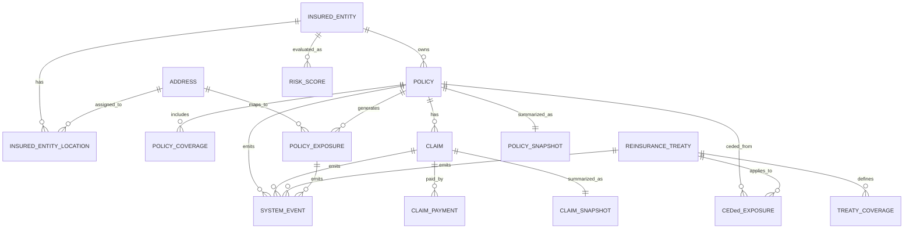

# Insurance Dashboard ERD (PostgreSQL)

This document contains the ERD for a general-purpose insurer dashboard.

## Mermaid ERD

---

## Core Entities

### INSURED_ENTITY
- id (uuid)
- name (text)
- entity_type (text)

### ADDRESS
- id (uuid)
- city (text)
- state (text)
- country (text)
- latitude (float)
- longitude (float)
- geo_hash (text)

### POLICY
- id (uuid)
- policy_number (text)
- status (text)
- effective_date (date)
- expiry_date (date)
- total_limit (numeric)
- premium (numeric)

### POLICY_COVERAGE
- id (uuid)
- coverage_type (text)
- limit_amount (numeric)

### CLAIM
- id (uuid)
- status (text)
- claimed_amount (numeric)
- reserved_amount (numeric)

### CLAIM_PAYMENT
- id (uuid)
- amount (numeric)
- payment_date (timestamp)

### POLICY_EXPOSURE
- id (uuid)
- exposure_amount (numeric)
- peril_type (text)
- risk_score (numeric)

### REINSURANCE_TREATY
- id (uuid)
- treaty_name (text)
- attachment_point (numeric)
- exhaustion_point (numeric)

### TREATY_COVERAGE
- id (uuid)
- line_of_business (text)
- cession_percentage (numeric)

### CEDed_EXPOSURE
- id (uuid)
- ceded_amount (numeric)
- retained_amount (numeric)

### SYSTEM_EVENT
- id (uuid)
- event_type (text)
- entity_type (text)
- entity_id (uuid)
- payload (jsonb)

### POLICY_SNAPSHOT
- policy_id (uuid)
- status (text)
- premium (numeric)
- total_limit (numeric)

### CLAIM_SNAPSHOT
- claim_id (uuid)
- status (text)
- total_paid (numeric)
- reserved_amount (numeric)

### RISK_SCORE
- id (uuid)
- entity_id (uuid)
- entity_type (text)
- score (numeric)
- factors (jsonb)
