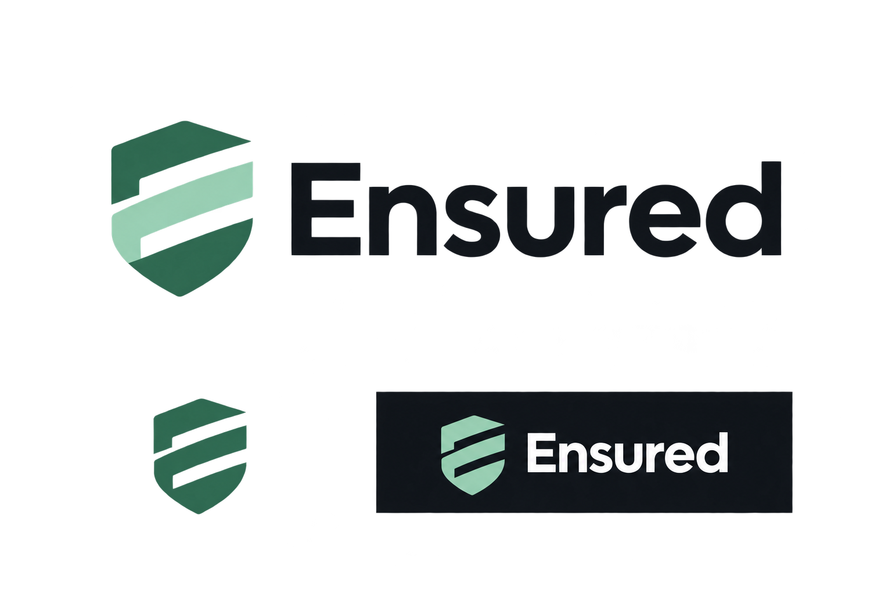
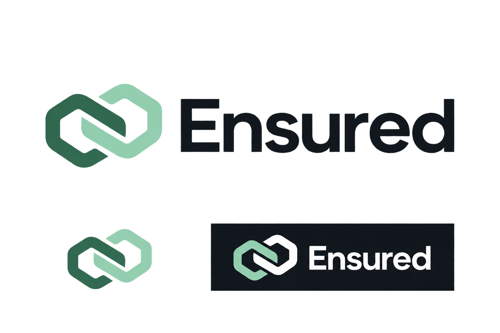
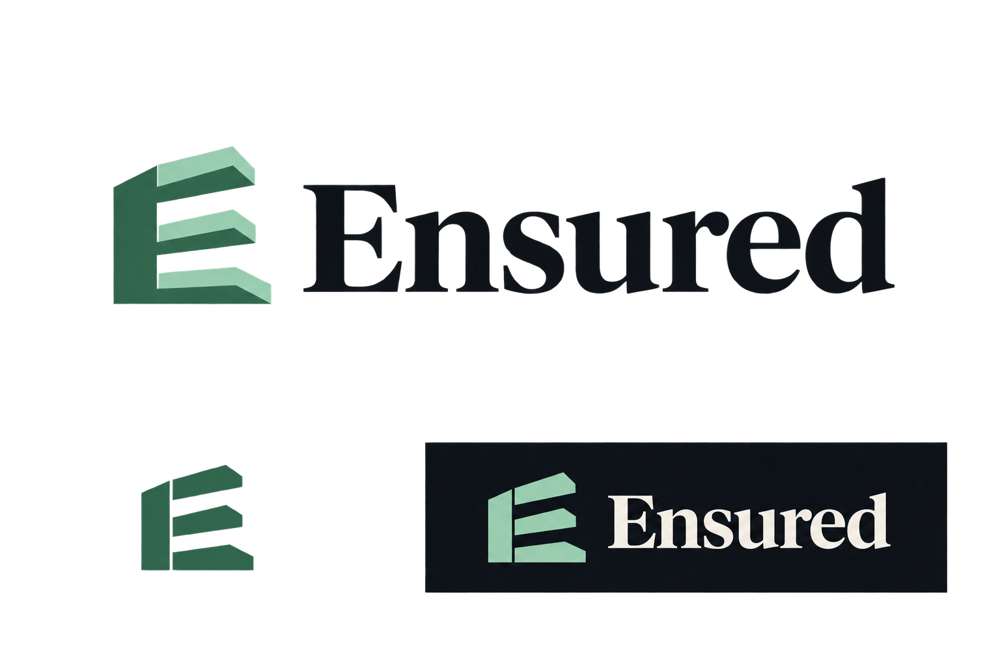
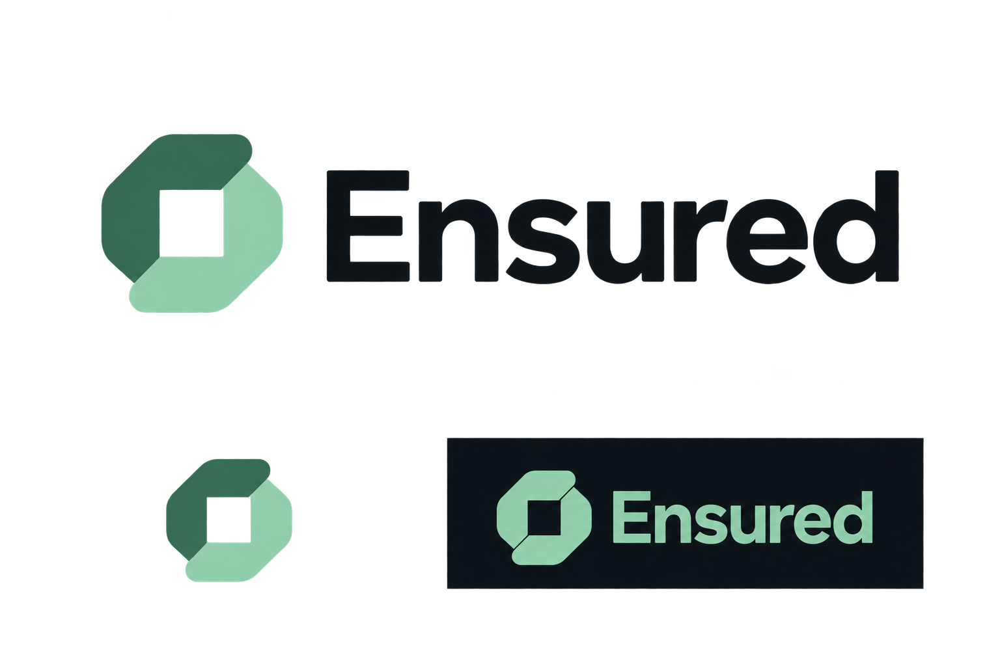
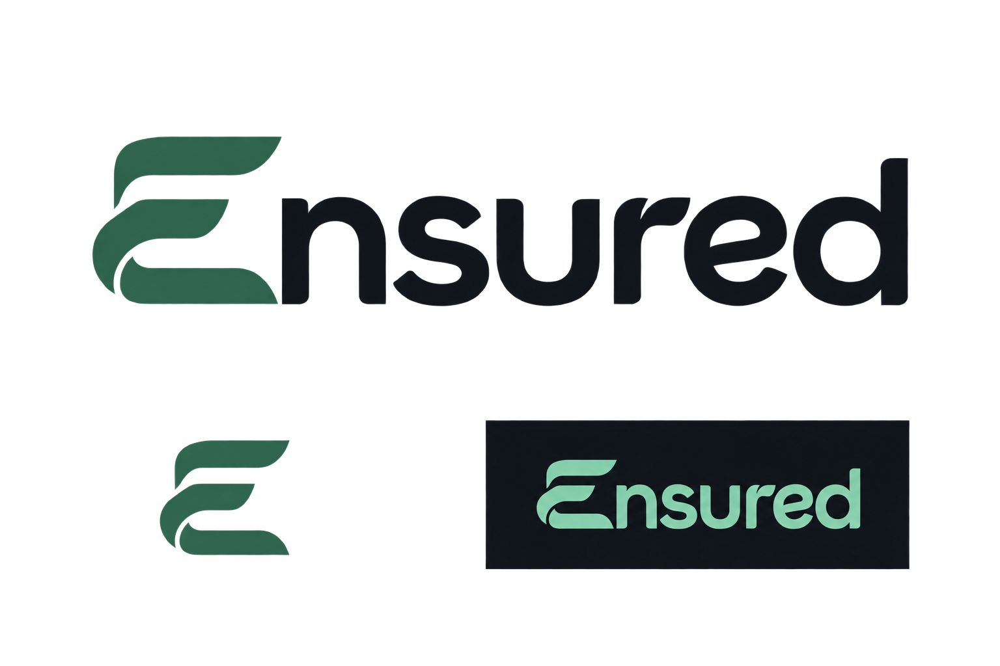

# Ensured logo concepts

Generated with the built-in imagegen tool. These are raster concept sheets for selection and refinement.

## 01-protective-e

Prompt:

Use case: logo-brand. Create one polished potential logo for Ensured, an institutional insurance and reinsurance marketplace connecting risk with capital. Exact wordmark text: "Ensured". Use flat, vector-friendly geometry with crisp edges, considered typography, strong small-size legibility, no gradients, shadows, 3D or stock mockups. Palette derived from platform: forest green #2d6a4f, mint #95d4b3, charcoal #0f141b, warm white #f0e6d8. Present on a clean landscape white concept sheet: one large primary horizontal symbol + wordmark lockup centered in upper two-thirds, and two modest small previews below, the symbol alone in forest on white and full logo in mint/white on a charcoal rectangular swatch. Keep generous whitespace. No labels, slogan, extra words, annotations, or decorative objects. The main logo should be ready for a software navigation bar, credible and distinctive. Design direction: Protective E. A bold compact shield silhouette constructed from three simple geometric strokes that also clearly suggest the letter E through negative space. A subtle protection cue, editorial precision, no checkmarks. Pair with a clean confident moderately weighted sans serif wordmark.

## 02-capital-link

Prompt:

Use case: logo-brand. Create one polished potential logo for Ensured, an institutional insurance and reinsurance marketplace connecting risk with capital. Exact wordmark text: "Ensured". Use flat, vector-friendly geometry with crisp edges, considered typography, strong small-size legibility, no gradients, shadows, 3D or stock mockups. Palette derived from platform: forest green #2d6a4f, mint #95d4b3, charcoal #0f141b, warm white #f0e6d8. Present on a clean landscape white concept sheet: one large primary horizontal symbol + wordmark lockup centered in upper two-thirds, and two modest small previews below, the symbol alone in forest on white and full logo in mint/white on a charcoal rectangular swatch. Keep generous whitespace. No labels, slogan, extra words, annotations, or decorative objects. The main logo should be ready for a software navigation bar, credible and distinctive. Design direction: Capital Link. Two substantial interlocking open geometric links form one balanced compact abstract symbol expressing exchange and partnership between insurance risk and capital. Avoid infinity-symbol cliches; make the interlock elegant, unexpected and minimal, only two forms. Pair with a refined humanist sans serif wordmark.

## 03-keystone

Prompt:

Use case: logo-brand. Create one polished potential logo for Ensured, an institutional insurance and reinsurance marketplace connecting risk with capital. Exact wordmark text: "Ensured". Use flat, vector-friendly geometry with crisp edges, considered typography, strong small-size legibility, no gradients, shadows, 3D or stock mockups. Palette derived from platform: forest green #2d6a4f, mint #95d4b3, charcoal #0f141b, warm white #f0e6d8. Present on a clean landscape white concept sheet: one large primary horizontal symbol + wordmark lockup centered in upper two-thirds, and two modest small previews below, the symbol alone in forest on white and full logo in mint/white on a charcoal rectangular swatch. Keep generous whitespace. No labels, slogan, extra words, annotations, or decorative objects. The main logo should be ready for a software navigation bar, credible and distinctive. Design direction: Keystone. An architectural abstract capital E monogram made of three horizontal structural slabs and one purposeful vertical anchor, forming a stable compact emblem with subtle upward progression. Very restrained, substantial, high-end institutional identity. Pair with a sophisticated contemporary serif Ensured wordmark with sturdy readable strokes.

## 04-coverage

Prompt:

Use case: logo-brand. Create one polished potential logo for Ensured, an institutional insurance and reinsurance marketplace connecting risk with capital. Exact wordmark text: "Ensured". Use flat, vector-friendly geometry with crisp edges, considered typography, strong small-size legibility, no gradients, shadows, 3D or stock mockups. Palette derived from platform: forest green #2d6a4f, mint #95d4b3, charcoal #0f141b, warm white #f0e6d8. Present on a clean landscape white concept sheet: one large primary horizontal symbol + wordmark lockup centered in upper two-thirds, and two modest small previews below, the symbol alone in forest on white and full logo in mint/white on a charcoal rectangular swatch. Keep generous whitespace. No labels, slogan, extra words, annotations, or decorative objects. The main logo should be ready for a software navigation bar, credible and distinctive. Design direction: Coverage. Two offset rounded angular enclosing forms create a distinctive protected central square through negative space, representing coverage and distributed risk. A single unified compact emblem, simple silhouette, no shield, no checkmark, no tiny nodes. Pair with a precise modern sans serif wordmark with subtly softened terminals.

## 05-signature

Prompt:

Use case: logo-brand. Create one polished potential logo for Ensured, an institutional insurance and reinsurance marketplace connecting risk with capital. Exact wordmark text: "Ensured". Use flat, vector-friendly geometry with crisp edges, considered typography, strong small-size legibility, no gradients, shadows, 3D or stock mockups. Palette derived from platform: forest green #2d6a4f, mint #95d4b3, charcoal #0f141b, warm white #f0e6d8. Present on a clean landscape white concept sheet: one large primary horizontal symbol + wordmark lockup centered in upper two-thirds, and two modest small previews below, the symbol alone in forest on white and full logo in mint/white on a charcoal rectangular swatch. Keep generous whitespace. No labels, slogan, extra words, annotations, or decorative objects. The main logo should be ready for a software navigation bar, credible and distinctive. Design direction: Signature. A typography-led custom lowercase-feeling title-case wordmark spelled Ensured with a distinctive sculpted capital E formed from a continuous ribbon-like flat geometric stroke. The E should be strong enough to serve independently as an app icon. Main lockup is wordmark only, no separate symbol to its left. Refined custom sans lettering with one or two purposeful terminal details, understated and premium; avoid scripts. Small symbol preview below uses the same capital E.
